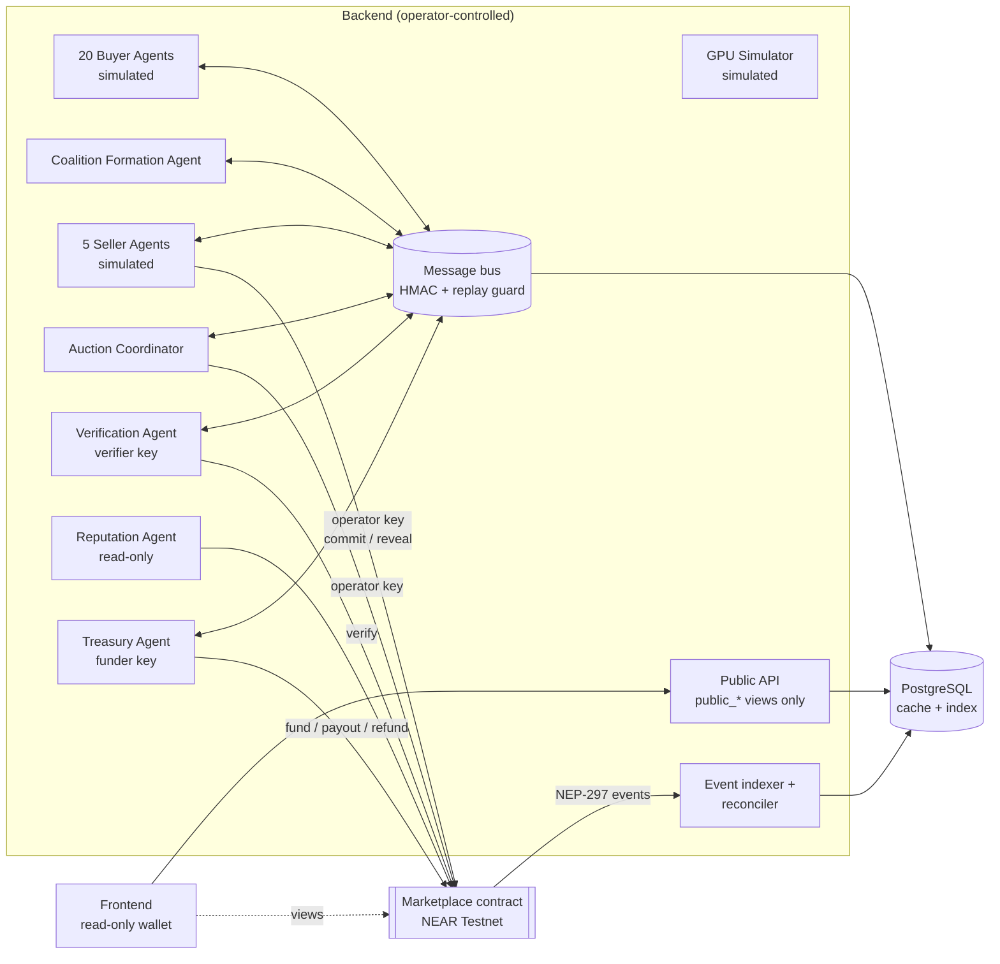
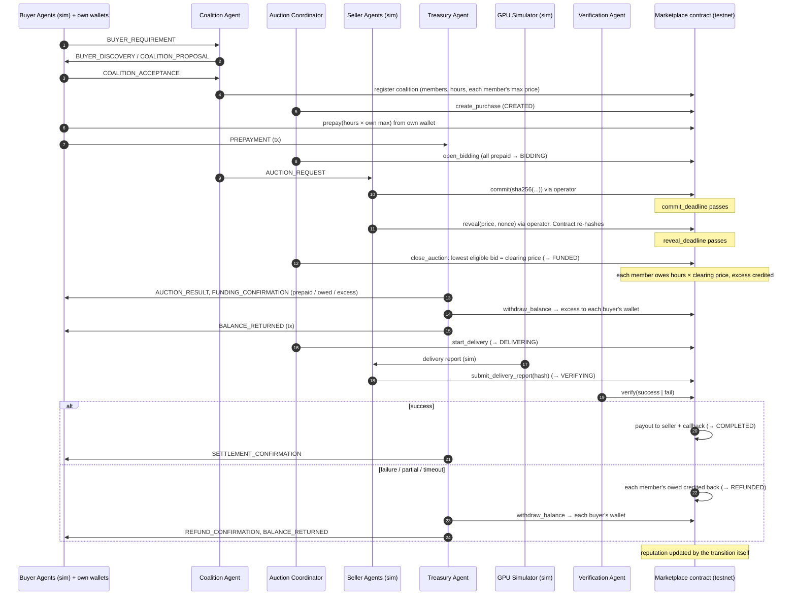

# SwarmCompute — Architecture

SwarmCompute is a demo GPU marketplace. Simulated buyer agents form coalitions, simulated seller agents compete in a commit-reveal sealed-bid reverse auction, and escrow, allocations, payouts, refunds and reputation execute on **NEAR Testnet**.

> **Real vs simulated.** All 25 agents, GPU delivery and delivery verification are simulated and controlled by the backend. The marketplace contract, the 20 buyer wallets, the 5 seller payout accounts, and every prepayment, payout, refund and returned balance are real (testnet). This is **not** a trustless system: the operator controls the agents, the buyer-wallet keys and the verifier role. See [SECURITY.md](SECURITY.md).

---

## 1. Technology choices

| Concern | Choice | Notes |
|---|---|---|
| Smart contract | Rust, `near-sdk`, built with `cargo near` | Exact SDK version is checked against NEAR docs at the start of Phase 2 |
| Contract tests | Rust unit tests + `near-workspaces` against NEAR Testnet | The sandbox doesn't run on Windows; see `contracts/marketplace/README.md` |
| Backend / agents | TypeScript on Node.js ≥ 20, ESM, run with `tsx` | Same language as the frontend and the official NEAR JS tooling |
| Schemas | Zod 3 | Shared by backend, agents and API |
| NEAR client | `near-api-js` / `@near-js/*` | Version chosen in Phase 6 |
| Database | PostgreSQL 16, plain SQL migrations | `docker-compose.yml` for local dev |
| Frontend | React + Vite, NEAR Wallet Selector (read-only) | Phase 8 |
| Monorepo | pnpm workspaces | |

## 2. Repository layout

```
swarmcompute/
├── SWARMCOMPUTE_PROMPT.md        authoritative spec
├── RULES.md                      engineering rules (R1–R18)
├── ARCHITECTURE.md               this file
├── .env.example                  every config variable, documented
├── docker-compose.yml            local PostgreSQL
├── package.json / pnpm-workspace.yaml / tsconfig.base.json
├── packages/
│   └── shared/                   @swarmcompute/shared
│       ├── src/money.ts          yocto bigint arithmetic, u128 bounds
│       ├── src/ids.ts            ID formats, agent kinds, testnet account validation
│       ├── src/commitment.ts     bid commitment encoding + sha256
│       └── src/messages/         envelope, payload schemas, HMAC signing, validation
├── apps/
│   ├── backend/                  @swarmcompute/backend
│   │   ├── src/config/env.ts     validated config (testnet enforcement)
│   │   ├── src/db/migrate.ts     migration runner
│   │   └── db/migrations/        SQL schema
│   └── frontend/                 (Phase 8)
└── contracts/
    └── marketplace/              (Phase 2) Rust contract
```

## 3. Components



### Keys and roles

| Contract role | Held by | Used for |
|---|---|---|
| `owner` | Deployment scripts only (never the running backend) | Role rotation, pause |
| `operator` | Backend: Auction Coordinator, seller agents, coalition registration | Register buyers (with wallet), sellers and coalitions (with member max prices); open auctions; commit and reveal on behalf of simulated sellers; start delivery; submit delivery reports; send balances to wallets |
| `verifier` | Verification Agent | `verify` |
| buyer wallet `buyerNNN.<parent>` | Backend, one key per demo (simulated buyers) | `prepay` for that buyer only |
| funder (off-contract) | Treasury, at setup | Tops up the buyer wallets with their budgets |

The roles are separate contract fields, so they can be split across accounts. In the demo they are the same account.

## 4. Settlement flow: collective buying at one fair price



## 5. Escrow state machine

```mermaid
stateDiagram-v2
  [*] --> CREATED
  CREATED --> BIDDING: open_bidding (every member prepaid)
  CREATED --> EXPIRED: prepay deadline passed
  BIDDING --> FUNDED: close_auction (winner = clearing price; excess credited)
  BIDDING --> FAILED: close_auction (no eligible bid)
  FUNDED --> DELIVERING: start_delivery
  FUNDED --> EXPIRED: delivery deadline passed
  DELIVERING --> VERIFYING: submit_delivery_report
  DELIVERING --> EXPIRED: delivery deadline passed
  VERIFYING --> COMPLETED: verify(success) + payout callback ok
  VERIFYING --> FAILED: verify(fail)
  VERIFYING --> EXPIRED: verification deadline passed
  FAILED --> REFUNDED: each member's money credited back
  EXPIRED --> REFUNDED: each member's money credited back
  COMPLETED --> [*]
  REFUNDED --> [*]
```



Any transition not drawn panics. Anyone can `expire` a purchase past a deadline, or `close_auction` after the reveal deadline. Refunds are credited to each buyer's on-chain balance immediately. `withdraw_balance` (anyone may call it; the destination is fixed) sends the balance to the buyer's wallet with the same in-flight and callback guard as payouts.

**How this differs from the original spec Section 8** (decided 2026-11-08, for fair collective buying):
- **Prepay before bidding.** Members prepay their own maximum before bidding, which replaces AWARDED → `fund`.
- **Refunds go to buyers.** Refunds go to each buyer, not to a single funder.
- **Buyers have wallets.** Buyers have real wallets, where the spec had them walletless.
## 6. Bid commitment encoding (spec Section 7)

```
commitment = sha256( LP(auction_id) || LP(seller_id) || LP(price_be16) || LP(nonce) )
LP(x)      = u32 big-endian length of x, then x
auction_id, seller_id : UTF-8
price_be16            : price_per_hour_yocto as u128, 16 bytes big-endian
nonce                 : 32 random bytes
```

Commitments and nonces travel as 64-character lowercase hex.

**Shared test vector.** The TypeScript implementation is tested against this vector, and the Rust contract tests must reproduce it:

| Field | Value |
|---|---|
| auction_id | `auction-0001` |
| seller_id | `seller-01` |
| price_per_hour_yocto | `1000000000000000000000000` (1 NEAR) |
| nonce | `000102…1e1f` (bytes 0..31) |
| commitment | `c80c9bf2feaea19846ff2eca8baacb87a274d7ad8eb08c30692cb515e651c2ee` |

Confidentiality limit: the backend generates every bid and nonce, so commit-reveal hides bids from other sellers and the public, **not** from the operator.

## 7. Agent message protocol (spec Section 11)

**Envelope** (`packages/shared/src/messages/envelope.ts`):

```jsonc
{
  "message_id": "uuid",
  "sender_id": "buyer-001",
  "receiver_id": "coalition-agent",
  "type": "BUYER_REQUIREMENT",
  "timestamp": "2026-11-06T12:00:00.000Z",
  "coalition_id": null, "auction_id": null, "purchase_id": null,
  "payload": { /* strict, type-specific; money as decimal strings */ },
  "status": "PENDING",
  "signature": "hex HMAC-SHA256"
}
```

**Signing.** Per-agent key = `HMAC-SHA256(AGENT_HMAC_MASTER_SECRET, "swarmcompute/agent-key/v1/" + agent_id)`. Signature = `HMAC-SHA256(agent_key, canonicalJson(envelope − signature − status))`. Canonical JSON sorts keys, has no whitespace, and allows only safe-integer numbers. `status` is excluded from the signature because it is the receiver's processing state.

**Validation order** (`validate.ts`):
1. Known type → `UNKNOWN_TYPE`
2. Envelope shape, status must be `PENDING` → `MALFORMED_ENVELOPE`
3. Sender kind allowed for the type → `UNAUTHORIZED_SENDER`
4. Sender key exists and HMAC matches → `UNKNOWN_SENDER` / `BAD_SIGNATURE`
5. Strict payload schema, including cross-field rules → `INVALID_PAYLOAD`
6. `payload.buyer_id` / `seller_id` equals the sender → `UNAUTHORIZED_SENDER`
7. Envelope context IDs match payload IDs → `CONTEXT_MISMATCH`
8. Timestamp within `MESSAGE_MAX_AGE_SECONDS` (and ≤ 30 s in the future) → `STALE`
9. Message ID not seen before → `REPLAY` (checked last, so rejected messages don't consume IDs)

**Sender rules**

| Type | Sender | On-chain tx_hash |
|---|---|---|
| BUYER_REQUIREMENT, COALITION_ACCEPTANCE/REJECTION/LEAVE, CONTRIBUTION_APPROVAL (legacy, unused) | Buyer (self) | – |
| PREPAYMENT (hours × own max, from own wallet; schema checks the product) | Buyer (self) | required |
| BUYER_DISCOVERY, COALITION_PROPOSAL, AUCTION_REQUEST | Coalition agent | – |
| SELLER_AVAILABILITY | Seller (self) | – |
| BID_COMMITMENT, BID_REVEAL, DELIVERY_REPORT | Seller (self) | required |
| AUCTION_RESULT | Auction coordinator | required |
| VERIFICATION_RESULT | Verification agent | required |
| FUNDING_CONFIRMATION (per member: clearing price, prepaid, owed = hours × price, excess = prepaid − owed; schema checks both), SETTLEMENT_CONFIRMATION, REFUND_CONFIRMATION, BALANCE_RETURNED | Treasury agent | required |

**Status lifecycle.** Senders send `PENDING`. A message that passes validation is logged as `ACCEPTED`. A message carrying a tx hash becomes `CONFIRMED` only after the backend verifies that transaction via RPC (Phase 6). Failures are logged as `REJECTED` with a code. Every message is logged (`agent_messages`), including rejected ones.

## 8. Data model (spec Section 13)

`apps/backend/db/migrations/0001_init.sql` creates the 20 specified tables, plus `refund_lines` (per-buyer refund breakdown) and `contract_events` (indexed NEP-297 events).

- **The contract is authoritative.** The DB caches and indexes. `purchases` carries `last_synced_block_height` and `drift_detected` / `drift_detail` for the reconciler.
- **Money**: the `yocto` domain (`NUMERIC(40,0)`, 0 ≤ v ≤ u128::MAX).
- **Simulated-only columns** (`gpu_resources.is_simulated`, `deliveries.is_simulated`, `verification_records.is_simulated`) are constrained `TRUE`.
- **Settlement idempotency** is mirrored in the DB: partial unique indexes allow at most one `SUCCEEDED` and one `IN_FLIGHT` payout or refund per purchase.
- **Secrets**: unrevealed price and nonce are stored as AES-256-GCM ciphertext (`iv ‖ ct ‖ tag`, key `BID_ENCRYPTION_KEY`, versioned) and wiped after a confirmed reveal.
- **Public views**: `public_sellers`, `public_bid_commitments`, `public_auction_commitment_counts`, `public_bid_reveals` and `public_agent_messages` (redacts unconfirmed `BID_REVEAL` payloads). The public API reads only these views.

## 9. Determinism

Coalition formation and seller behaviour use a seeded PRNG derived from `SIMULATION_SEED` (Phases 3–4). Inputs are sorted by ID before processing, so the same seed and inputs always produce the same coalitions and bids.

## 10. Open items, verified in later phases

| Item | Phase |
|---|---|
| ~~Current `near-sdk` / `cargo-near` / `near-workspaces` versions~~ Resolved: 5.30.1 / 0.23.0 / 0.24.0 (crates.io, 2026-11-07) | 2 |
| ~~Storage-deposit model~~ Resolved: owner pre-funds contract storage | 2 |
| ~~Sandbox tests~~ The sandbox has no Windows build, so contract tests are unit tests plus testnet tests (`contracts/marketplace/README.md`) | 2 |
| ~~Testnet RPC provider and runtime `chain_id` check~~ Resolved: `https://test.rpc.fastnear.com`. `NearChain.connect` refuses any RPC whose `chain_id` isn't `testnet` | 6 |
| ~~Exact NEAR JS client package and version~~ Resolved: `near-api-js` 7.4.0 (the `@near-js/*` packages stopped updating in 2025) | 6 |
| ~~Seller payout sub-accounts creation~~ Resolved: `testnet:setup` creates `seller1..5.<dev>.testnet` | 6 |
| Indexing scope: the indexer reads only transactions this backend submitted. Third-party calls (e.g. someone else's `expire`) show up as drift in the reconciler, not as indexed events | 6 (by design) |
