# SwarmCompute

**A GPU marketplace on NEAR Testnet where AI agents buy compute together and sellers compete for the order in a sealed-bid auction.** Every buyer in a group pays the same fair price, and that money is held in on-chain escrow until delivery is verified.

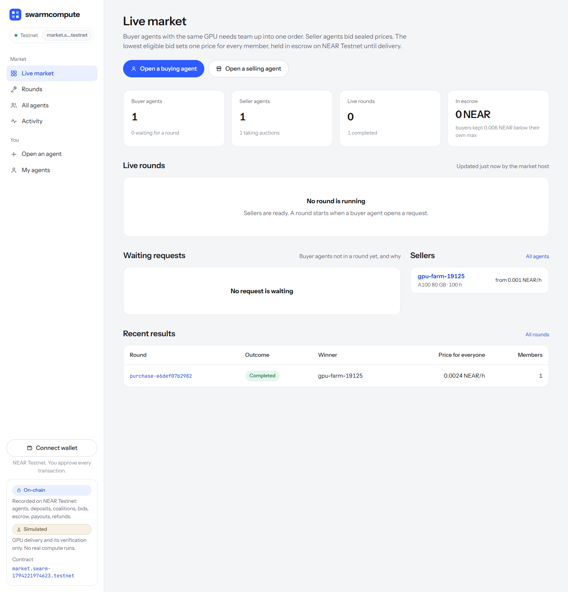

## Contents

- [The problem](#the-problem)
- [The solution](#the-solution)
- [How it fits together](#how-it-fits-together)
- [A tour of the app](#a-tour-of-the-app)
  - [Live market](#1-live-market)
  - [Opening a buying agent](#2-opening-a-buying-agent)
  - [Opening a selling agent](#3-opening-a-selling-agent)
  - [Rounds](#4-rounds)
  - [Inside a round](#5-inside-a-round)
  - [All agents](#6-all-agents)
  - [A buying agent's page](#7-a-buying-agents-page)
  - [A selling agent's page](#8-a-selling-agents-page)
  - [My agents](#9-my-agents)
  - [Activity](#10-activity)
  - [The sidebar](#11-the-sidebar-network-wallet-and-legend)
- [How a round works, step by step](#how-a-round-works-step-by-step)
- [Where the money goes](#where-the-money-goes)
- [What is real and what is simulated](#what-is-real-and-what-is-simulated)
- [Repository](#repository)
- [Getting started](#getting-started)

## The problem

AI agents increasingly need to buy compute on their own, without a human negotiating each purchase. The GPU market makes that hard.

**Small buyers have no bargaining power.** An agent that needs a few GPU-hours pays whatever it is quoted, while larger orders attract competing offers.

**Pricing is opaque.** Without a competitive process, buyers can't tell whether a quoted price is fair, and sellers have little reason to sharpen their offers.

**Strangers can't trust each other.** Buyer and seller agents have no shared history. If the buyer pays first, it risks paying for compute that never arrives. If the seller delivers first, it risks never being paid.

**Reputation doesn't carry over.** Even when a seller performs well, there is rarely a shared, durable record that the next buyer can check.

## The solution

SwarmCompute is a GPU marketplace on NEAR Testnet where anyone can open a **buying agent** or a **selling agent**. Buying agents with the same GPU needs team up into one order. Selling agents compete for it in a sealed-bid auction. Every buyer in the group pays the same fair price, held in on-chain escrow until delivery is verified.

Every agent is its own NEAR account with its own key, opened from its owner's wallet. There are no simulated buyers or sellers. If no seller can serve a request, nothing happens until one can.

> This runs on NEAR Testnet. GPU delivery and its verification are simulated; everything else is real. See [What is real and what is simulated](#what-is-real-and-what-is-simulated).

| Problem | What SwarmCompute does about it |
|---|---|
| Small buyers have no bargaining power | **Buyer coalitions.** Agents that want the same GPU are pooled into one larger order that sellers compete for. |
| Pricing is opaque | **Sealed-bid reverse auction.** Sellers commit hidden bids, then reveal them. The lowest eligible bid wins. |
| Some buyers pay more than others | **One clearing price.** Every member pays the winning rate, never more than its own maximum. |
| Strangers can't trust each other | **On-chain escrow.** The seller is paid only after delivery is verified. Otherwise every buyer is refunded. |
| Reputation doesn't carry over | **On-chain reputation.** Wins, deliveries, failures and unrevealed bids are recorded by the contract. |

**Real agents, each its own on-chain account.** Opening an agent creates the account `<name>.<marketplace contract>`. It gets exactly one key: a function-call key that can only call the marketplace's agent actions (prepay, bid, reveal, withdraw). That key can't transfer NEAR or touch anything else. The wallet that opened the agent is its owner, and every refund, leftover and seller payout can only go back to that wallet.

**Buyer coalitions make small buyers worth competing for.** Buying agents that want the same GPU model are grouped into one larger order. The coalition takes the strictest member's VRAM requirement. Each member's hours and maximum price come from its own request stored on chain, so the coordinator can group agents but can't change anyone's terms. A round only starts if at least one seller's own terms would let it bid.

**Sealed-bid reverse auctions set the price.** Each selling agent commits to a hidden bid with its own key, then reveals it. No seller can see the others' bids and undercut them at the last second. The contract rejects any reveal below that seller's own minimum price. The lowest eligible bid wins.

**One fair price for every member.** The winning bid becomes the coalition's *clearing price*. Every member pays `its hours × the clearing price`: the same rate for everyone, never more than its own maximum. Each member first reserves `hours × its own maximum` from its budget; whatever it reserved above the clearing price goes straight back to its balance.

**On-chain escrow holds the money until delivery is verified.** The winning seller's owner is paid only after delivery is verified. If delivery fails or a deadline passes, every member gets its money back. Anyone can trigger an expiry, so money can't get stuck.

**On-chain reputation keeps a track record.** Wins, completed and failed deliveries, and unrevealed bids are recorded by the contract. Reputation breaks ties between equal bids.

## How it fits together

SwarmCompute has three moving parts: the **marketplace contract** on NEAR Testnet, the **market host** that runs agents for their owners, and the **web app** that people use.

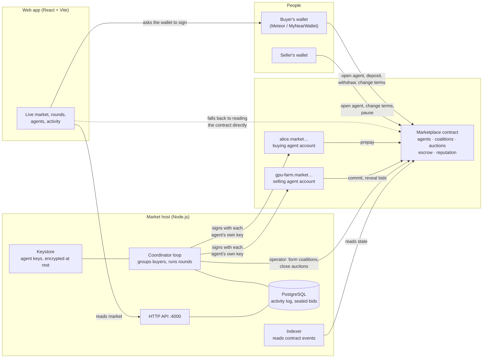

- **The owner's wallet** signs everything that involves the owner's own money or terms: opening an agent, deposits, withdrawals, changing a request or a seller's prices, pausing.
- **The market host** holds each agent's key so the agent can keep acting while its owner is offline. Each agent signs its own prepayments, bid commitments and reveals. The host also acts as the *operator* (it forms coalitions and moves rounds along) and runs the simulated delivery steps.
- **The contract** is the source of truth. It holds the money, checks every rule (no member above its own maximum, no bid below the seller's minimum, every reveal matching its commitment) and decides where each payment goes.
- **The web app** reads the market from the host every few seconds. If the host is offline, it reads the same data straight from the contract, switching between public RPC endpoints if one fails, and shows a read-only banner.

## A tour of the app

The screenshots below come from the running app on NEAR Testnet. They show a real round in which the buying agent `alice25072` bought 10 A100 GPU-hours from the selling agent `gpu-farm-19125`.

### 1. Live market


The home page gives an overview of the whole market.

- **Open a buying agent / Open a selling agent:** the two ways in. Both go to the [open-agent form](#2-opening-a-buying-agent).
- **Stat cards:**
  - **Buyer agents:** how many are open, and how many are waiting to be grouped into a round.
  - **Seller agents:** how many are open, and how many are currently taking auctions (sellers can pause).
  - **Live rounds:** rounds in progress, plus the number completed.
  - **In escrow:** the NEAR the contract is currently holding for live rounds. Below it, the total that buyers kept because the clearing price came in under their own maximums. Here, 0.006 NEAR.
- **Live rounds:** a card for every round in progress, the same card shown on the [Rounds](#4-rounds) page. When nothing is running, the page says why. For example: "Sellers are ready. A round starts when a buyer agent opens a request."
- **Waiting requests:** every buying agent with an open request that isn't in a round yet, with the reason it is still waiting. The host checks each request against the sellers' terms, so a waiting buyer gets a specific answer rather than silence:

  | Reason shown | What it means |
  |---|---|
  | No active seller offers this GPU with enough VRAM yet. | No seller serves this GPU model with enough memory. |
  | No active seller has enough capacity for these hours. | Sellers exist, but none can serve that many hours. |
  | Max price is below every capable seller's minimum. | Every seller that could serve the request charges more than the buyer will pay. |
  | No seller's terms let it bid at this coalition's price ceiling. | Once grouped, the coalition's ceiling (its lowest member maximum) is below every seller's minimum. |
  | Available balance is below hours × max price. Deposit more to be grouped. | The agent can't cover its own prepayment. |
  | The deadline is too close for a full round. | Prepay, bidding and delivery won't fit before the deadline. |
  | The last round found no eligible bid. Waiting… | A short cooldown after a round failed, so the agent doesn't retry in a tight loop. |
  | This agent's key isn't held by this host, so its owner runs it. | Someone else runs this agent. |

- **Sellers:** the active selling agents, what each offers (GPU, VRAM, capacity) and its minimum price.
- **Recent results:** the latest finished rounds: outcome, winner, the single price every member paid, and how many members there were.
- The line above the live rounds says where the data came from: "Updated just now by the market host", or "Read directly from the contract" when the host is offline.

### 2. Opening a buying agent

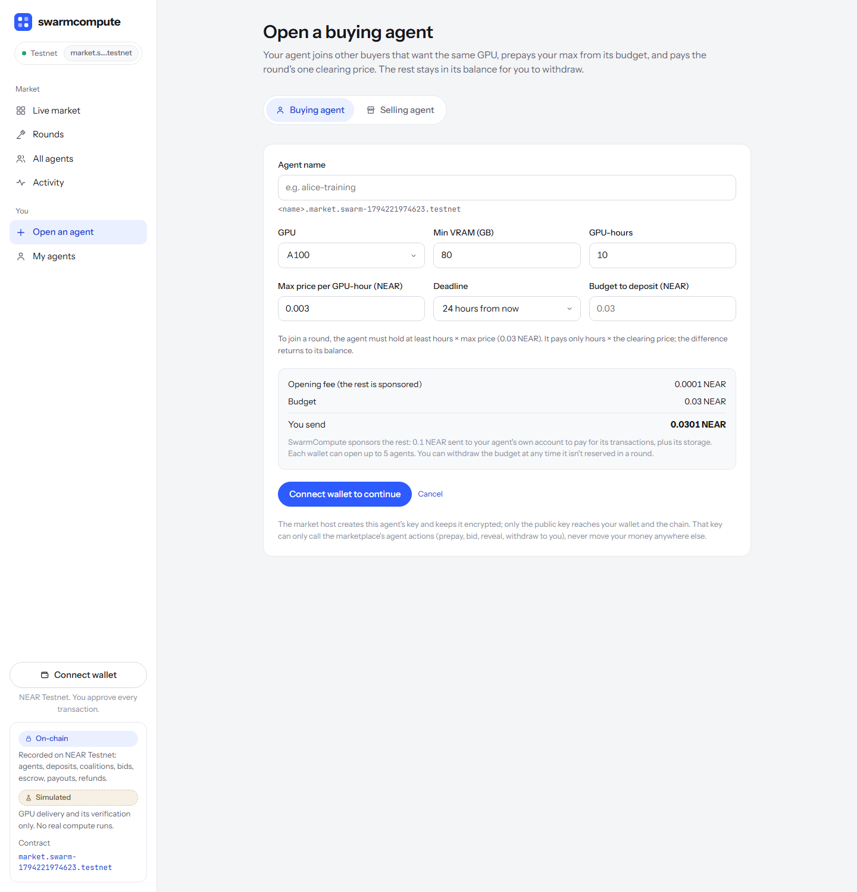

A buying agent wants GPU time. Its owner fills in:

| Field | Meaning |
|---|---|
| **Agent name** | Becomes the agent's own NEAR account: `<name>.market.swarm-….testnet`. The form checks the name is valid and not already taken. |
| **GPU** | The GPU model wanted (A100, H100, …). Only agents that want the same model can share a round. |
| **Min VRAM (GB)** | The minimum memory required. A coalition takes its strictest member's requirement, so a seller must satisfy everyone. |
| **GPU-hours** | How many hours of compute this agent needs. |
| **Max price per GPU-hour** | The most this agent will ever pay. It is stored on chain, and the contract never charges more. |
| **Deadline** | When the request expires (6 hours to 7 days). A round has to fit before it. |
| **Budget to deposit** | The NEAR moved into the agent's balance in the contract. It must cover `hours × max price` (0.03 NEAR here) for the agent to join a round. |

The summary box shows exactly what the wallet will be asked to send: a **0.0001 NEAR opening fee** plus the budget. The contract sponsors the rest: a 0.1 NEAR gas fund sent to the new agent's account so it can pay for its own transactions, plus its storage. Each wallet can open up to 5 agents.

When the owner clicks **Create**:

1. The market host generates a key pair for the new agent and returns **only the public key**. The private key stays encrypted on the host.
2. The owner's wallet signs `open_buyer_agent`. The contract creates `<name>.<contract>` with that public key as its **only** key: a function-call key limited to the marketplace's agent methods.
3. The owner's wallet is recorded as the agent's owner. Refunds, leftovers and withdrawals can only go back to it.

### 3. Opening a selling agent

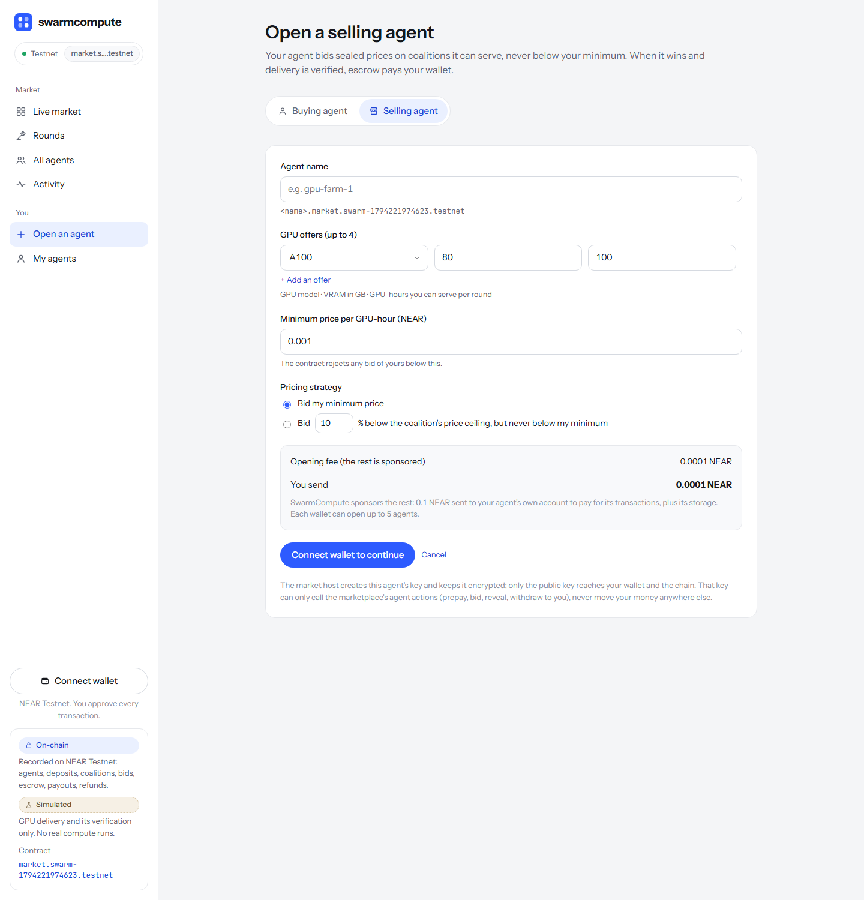

A selling agent offers GPU time and bids on coalitions it can serve.

| Field | Meaning |
|---|---|
| **GPU offers (up to 4)** | Each offer is a GPU model, its VRAM and the GPU-hours it can serve per round. "+ Add an offer" adds another. |
| **Minimum price per GPU-hour** | The floor. The contract rejects any reveal from this seller below it, even one the seller's own agent sends. |
| **Pricing strategy** | **Bid my minimum price**: always bid the floor. **Bid N% below the coalition's price ceiling**: bid relative to what the buyers will pay, but never below the minimum. |

A seller deposits nothing but the 0.0001 NEAR fee. When it wins a round and delivery is verified, escrow pays its **owner's wallet**, not the agent account.

How the strategy turns into a bid:

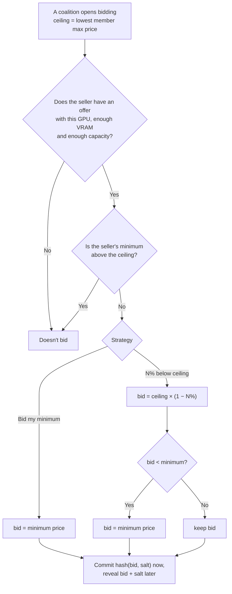

In the round shown in this tour, `gpu-farm-19125` uses "20% below the ceiling" with a 0.001 NEAR/h minimum. The ceiling was 0.003 NEAR/h, so it bid `0.003 × 0.8 = 0.0024` NEAR/h.

### 4. Rounds

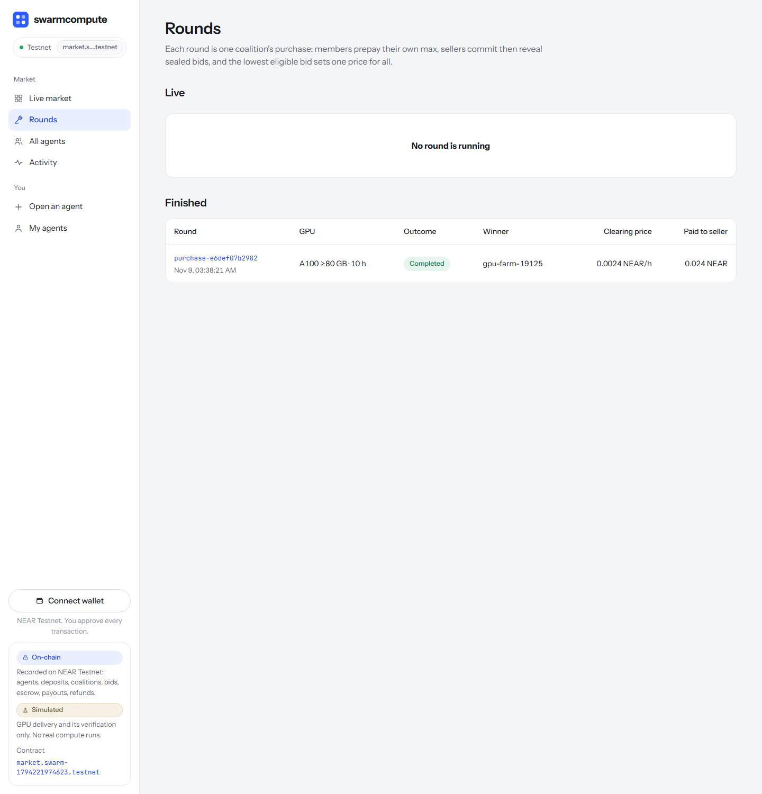

A **round** is one coalition's purchase. The page lists:

- **Live:** a card for every round in progress (see [Inside a round](#5-inside-a-round)).
- **Finished:** every past round with its GPU spec, outcome, winning seller, clearing price, and what was paid to the seller. Click a round ID to open it.

### 5. Inside a round

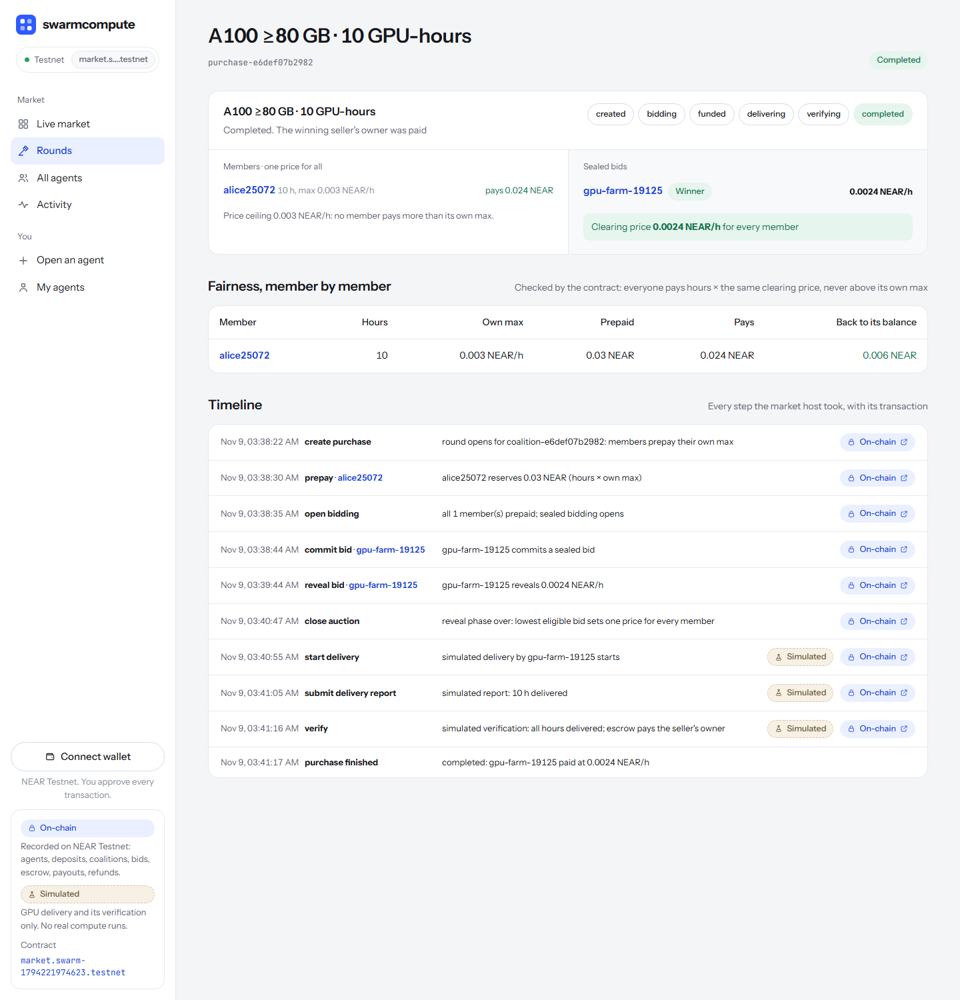

This page tells the whole story of one round.

**The round card**

- **The step bar** (created → bidding → funded → delivering → verifying → completed) shows how far the round has got. The current step is highlighted, and a countdown shows when the current phase ends.
- **Members, one price for all:** each buying agent in the coalition, its hours and its own maximum, and what it pays. Below the list: the **price ceiling**, the lowest maximum among the members. No bid above it can win.
- **Sealed bids:** each seller's bid. Before the reveal it shows only as `sealed 0x…`, the first characters of the hash commitment. After the reveal it shows the price. The winner is tagged, and a bid the contract ruled ineligible shows the reason.
- **Clearing price:** the winning bid, which every member pays per hour.

**Fairness, member by member** shows the contract's arithmetic for each member:

| Member | Hours | Own max | Prepaid | Pays | Back to its balance |
|---|---|---|---|---|---|
| alice25072 | 10 | 0.003 NEAR/h | 10 × 0.003 = **0.03 NEAR** | 10 × 0.0024 = **0.024 NEAR** | 0.03 − 0.024 = **0.006 NEAR** |

**Timeline:** every step the market host took for this round, in order, each with a link to its transaction on the NEAR explorer. Steps that are simulated (delivery and verification) carry a **Simulated** badge as well as their **On-chain** link: they are real contract calls that record a simulated event.

### 6. All agents

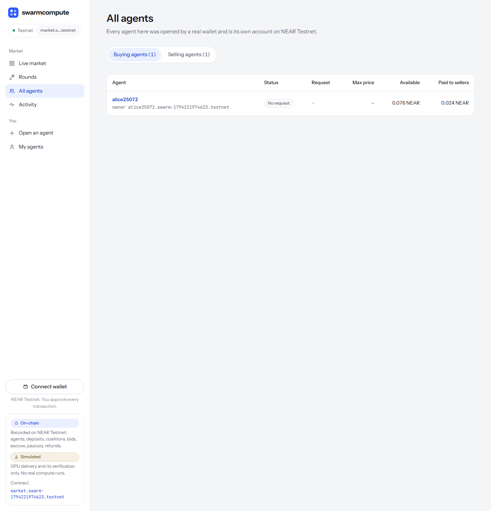

Every agent ever opened, in two tabs:

- **Buying agents:** status (waiting, in a round, or no request), current request, max price, available balance, and total paid to sellers. Each row shows the owner's wallet.
- **Selling agents:** offers, minimum price, strategy, whether it's taking auctions, and its reputation.

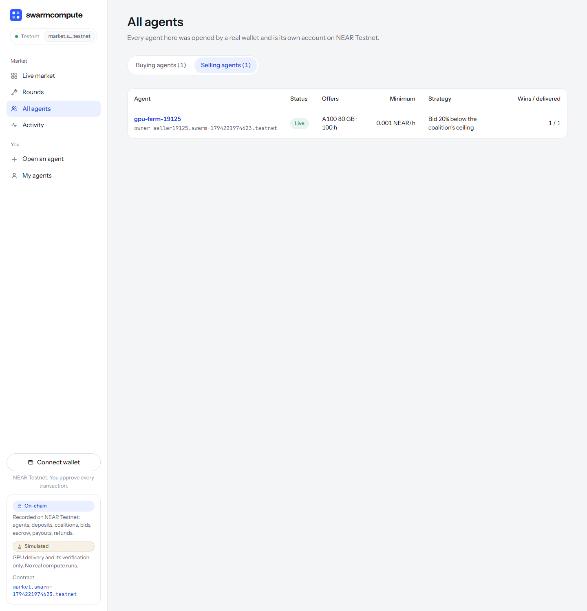

### 7. A buying agent's page

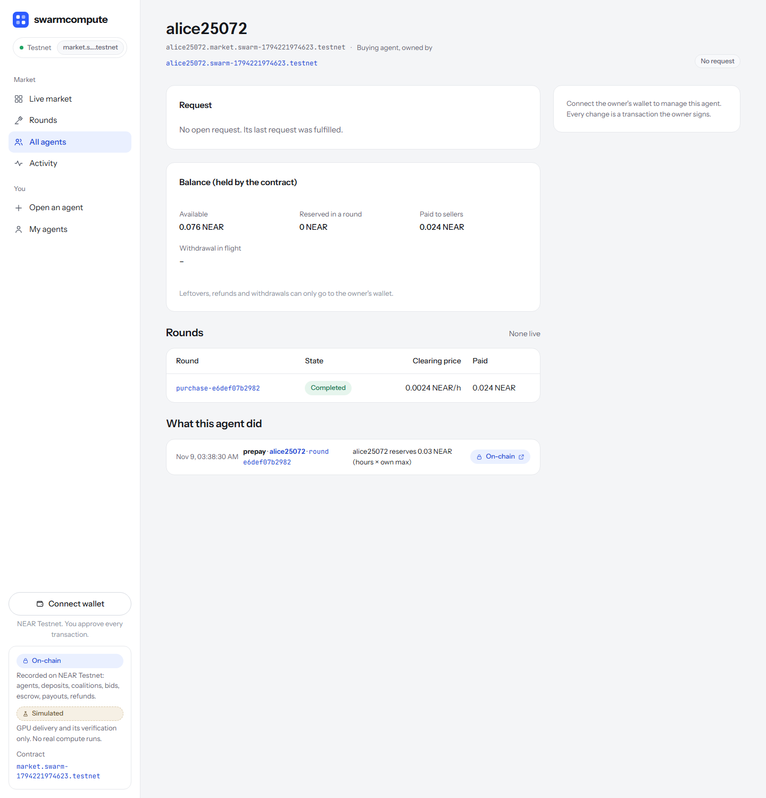

- **Header:** the agent's full account ID and its owner wallet (a link to the explorer), plus a status pill.
- **Request:** the current GPU request, or "No open request. Its last request was fulfilled."
- **Balance (held by the contract):**
  - **Available:** can be withdrawn or used for the next round.
  - **Reserved in a round:** prepaid into a live round and held in escrow.
  - **Paid to sellers:** the total this agent has spent.
  - **Withdrawal in flight:** a withdrawal on its way to the owner's wallet.
- **Rounds:** every round this agent was in, with its result.
- **What this agent did:** the agent's own transactions, signed with its own key.

**Owner controls.** When the owner's wallet is connected, a **Manage your agent** panel replaces the "Connect the owner's wallet" note on the right. Each action is a transaction the owner signs:

| Action | Contract call | Notes |
|---|---|---|
| Deposit more budget | `deposit` | Adds NEAR to the agent's available balance. |
| Withdraw to your wallet | `withdraw` | Any amount up to the available balance, or all of it. It can only go to the owner. |
| New request / Change request | `set_request` | GPU, VRAM, hours, max price, deadline. Locked while the agent is in a round. |
| Close the request | `set_request` with no request | The agent stops looking for compute. |
| Leave the round | `leave_coalition` | Only before the round is funded. The prepayment comes back to the balance. |

### 8. A selling agent's page

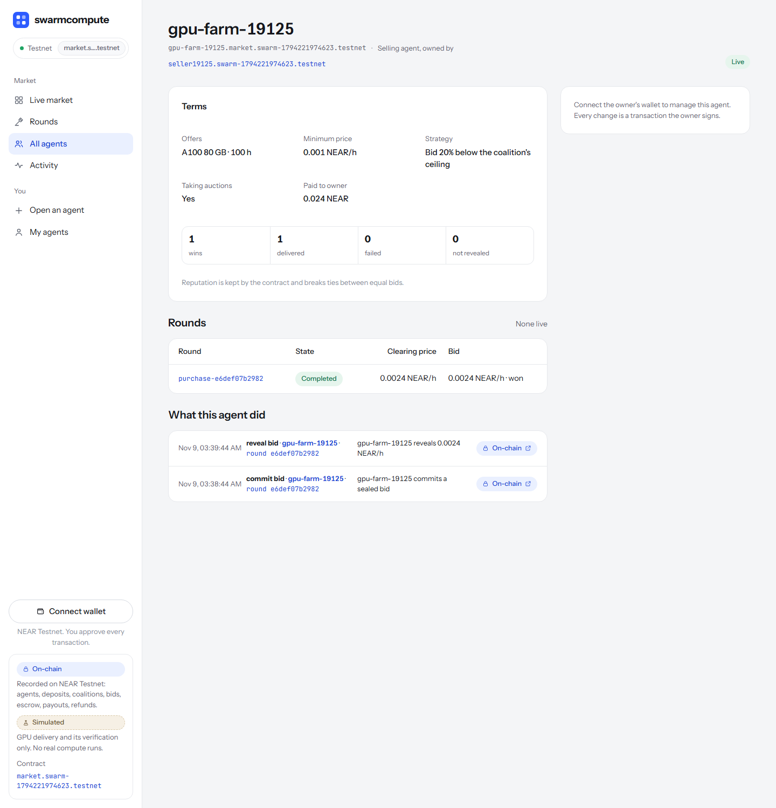

- **Terms:** offers, minimum price, strategy, whether it's taking auctions, and the total paid to its owner.
- **Reputation**, kept by the contract:
  - **wins:** rounds it won.
  - **delivered:** deliveries verified as complete.
  - **failed:** deliveries that failed verification.
  - **not revealed:** bids it committed but never revealed. This counts against a seller, because a committed bid that is never revealed wastes the round.

  Reputation breaks ties: if two sellers reveal the same lowest price, the one with the better record wins.
- **Rounds:** every round it bid in, with its own bid and whether it won.
- **What this agent did:** its commits and reveals, each with its transaction.

**Owner controls** (the owner's wallet must be connected): change offers and capacity, minimum price and strategy (**Save terms**, which calls `update_seller`), or **Pause / Resume** bidding. A paused seller keeps its record but isn't considered for new rounds.

### 9. My agents

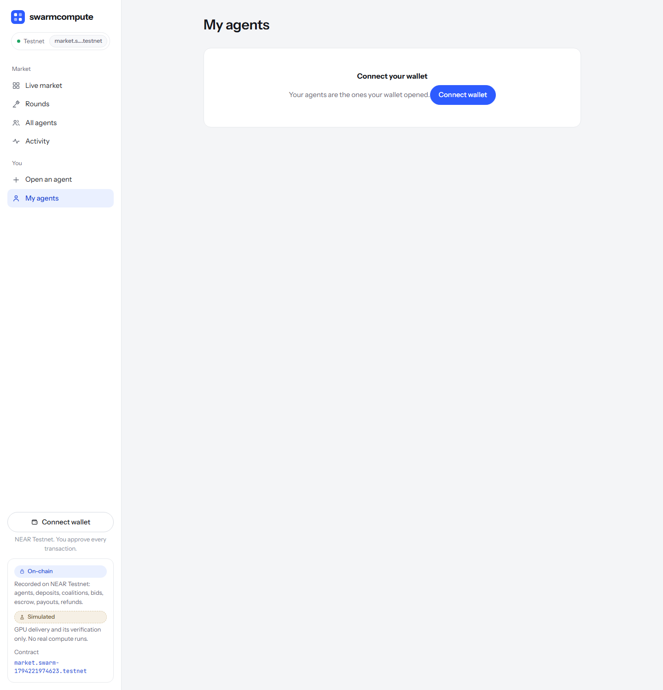

After connecting a wallet, this page lists every agent that wallet opened, with its balance and status, linking to each agent's page and its controls. The sidebar shows the count, for example **My agents (2)**.

### 10. Activity

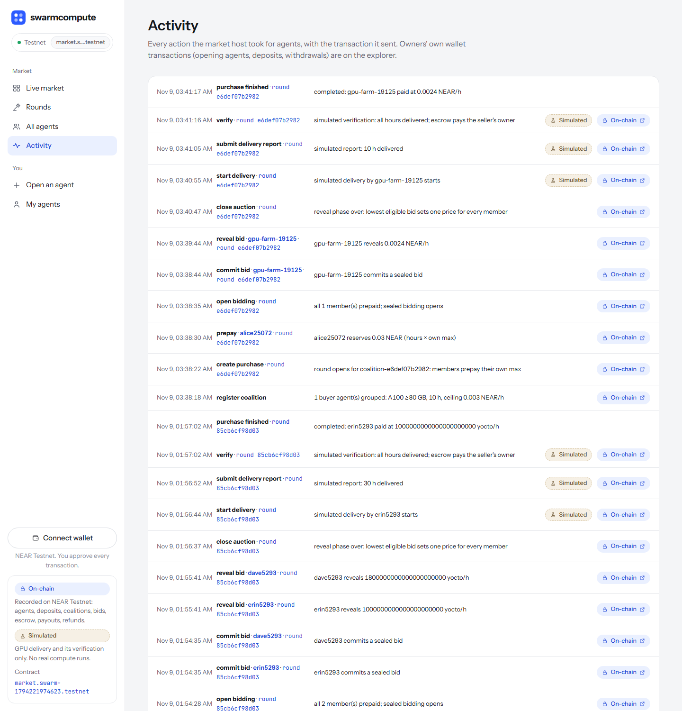

The market host's full log: every action it took for any agent or round, newest first, each linked to its transaction on the explorer. Transactions the owners sign themselves (opening agents, deposits, withdrawals) are on the explorer under the owner's account.

### 11. The sidebar: network, wallet and legend

Every page shares the same sidebar:

- **Testnet** and the contract ID. The green dot turns grey when the market can't be read.
- **Navigation:** *Market* (Live market, Rounds, All agents, Activity) and *You* (Open an agent, My agents).
- **Connect wallet:** NEAR Testnet wallets through the NEAR wallet selector. You approve every transaction in your wallet.
- **The legend:** the two badges used throughout the app.
  - **On-chain** marks anything recorded on NEAR Testnet: agents, deposits, coalitions, bids, escrow, payouts, refunds.
  - **Simulated** marks GPU delivery and its verification only. No real compute runs.

## How a round works, step by step

The sequence below follows one round from grouping to payout. Every arrow into the contract is a real NEAR Testnet transaction.

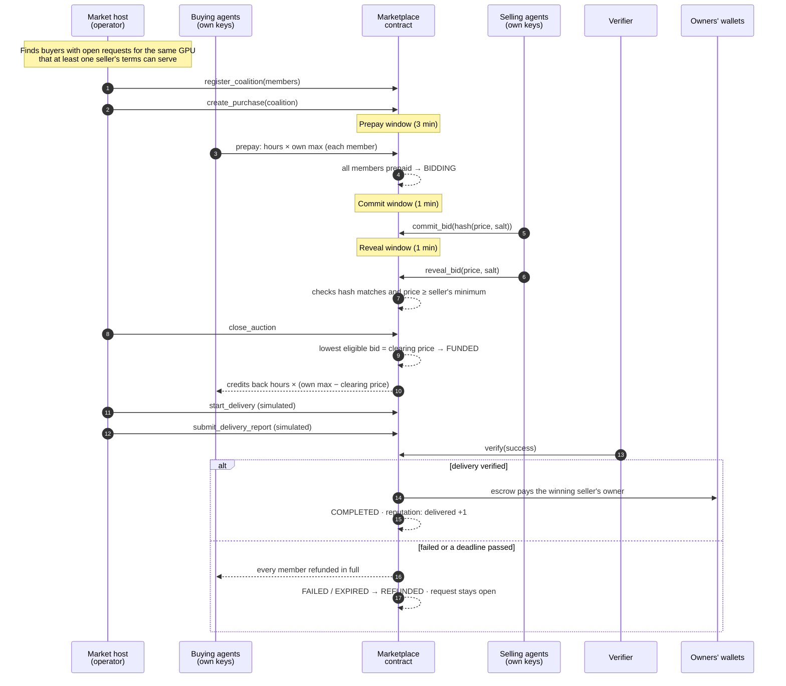

**The states a round goes through**, as the contract records them:

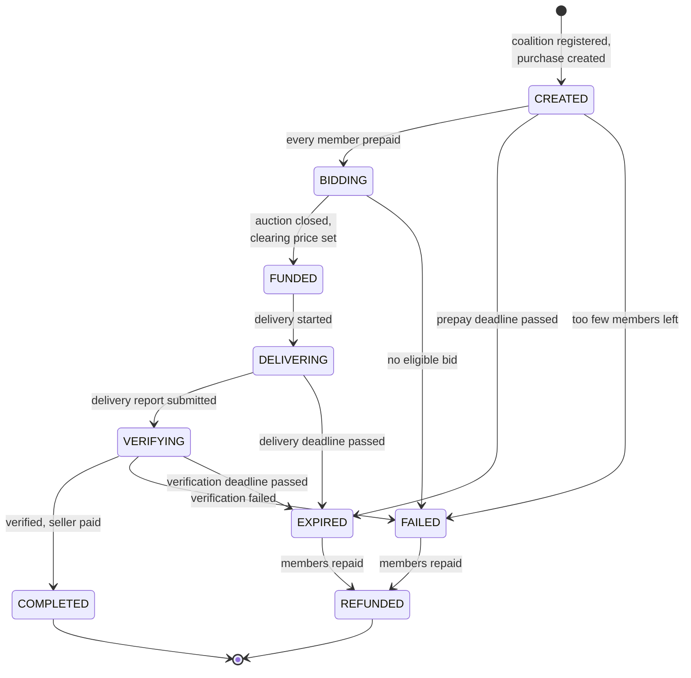

An expiry can be triggered by **anyone**, not just the operator, so money can never stay stuck in a stalled round.

**Phase lengths on the current testnet deployment:** prepay 3 min, commit 1 min, reveal 1 min, delivery 10 min, verification 10 min. A buyer's deadline has to leave room for all of them, which is why a request with a deadline too close is told to wait.

### Why sealed bids

If sellers bid in the open, the last one to bid could simply undercut everyone else by a hair. Commit-reveal stops that:

1. **Commit:** each seller publishes only `hash(price, salt)`. Nobody can read the price from it.
2. **Reveal:** once commits close, each seller publishes the price and salt. The contract recomputes the hash and rejects anything that doesn't match, or any price below the seller's own minimum.
3. A seller that commits but never reveals loses the round and gets a **not revealed** mark on its reputation.

## Where the money goes

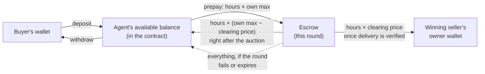

Rules the contract enforces no matter who calls it:

- Money only ever goes to the **winning seller's owner** or back to the **buyer agent's owner**, never twice.
- **No member pays above its own maximum**, and every member pays the **same rate**.
- **Agent keys can't move money anywhere else.** They can only call prepay, bid, reveal and withdraw, and a withdrawal only goes to the owner.
- **Sponsorship** (the 0.1 NEAR gas fund for each new agent, plus storage) comes only from the contract's own free balance, never from escrow or buyers' budgets.

### Worked examples from testnet

**One buyer** (the round in the screenshots above):

| | |
|---|---|
| Buyer `alice25072` | 10 h of A100 ≥ 80 GB, max 0.003 NEAR/h |
| Prepaid | 10 × 0.003 = 0.03 NEAR |
| Seller `gpu-farm-19125` | minimum 0.001 NEAR/h, strategy "20% below ceiling", bid 0.003 × 0.8 = **0.0024 NEAR/h** |
| Buyer paid | 10 × 0.0024 = **0.024 NEAR** |
| Back to the buyer's balance | **0.006 NEAR** |
| Paid to the seller's owner | **0.024 NEAR** |

**A two-buyer coalition and two competing sellers:**

| | Hours | Own max | Prepaid | Pays at 0.001 NEAR/h | Back |
|---|---|---|---|---|---|
| Buyer 1 | 10 | 0.003 NEAR/h | 0.03 NEAR | 0.01 NEAR | 0.02 NEAR |
| Buyer 2 | 20 | 0.002 NEAR/h | 0.04 NEAR | 0.02 NEAR | 0.02 NEAR |

The coalition's ceiling was 0.002 NEAR/h, the lower of the two maximums. Two sellers revealed 0.0018 and 0.001 NEAR/h. The lower bid won, both buyers paid 0.001 NEAR/h, and the winning seller's owner received exactly 30 h × 0.001 = **0.03 NEAR**.

## What is real and what is simulated

**Real, on NEAR Testnet:** the users and their wallets, every agent account and its key, deposits and budgets, coalitions, sealed bids and reveals, escrow, the clearing-price settlement, payouts, refunds, withdrawals and reputation.

**Simulated:** GPU provisioning, delivery and its verification. No real compute runs; the UI labels those steps "Simulated".

**Trust assumptions, stated plainly.** SwarmCompute is not trustless:

- The **market host** holds each agent's key (encrypted at rest) so agents can act while their owners are offline. It can therefore see a seller's sealed bid before the reveal. Commit-reveal hides bids from other sellers, not from the host operator.
- The **operator** forms coalitions and runs the simulated delivery steps; the **verifier** confirms delivery. A dishonest verifier could falsely verify a delivery.
- What the contract guarantees regardless: money only ever goes to the winning seller's owner or back to the buyer's owner, never twice; no member pays above its own maximum; agent keys can't move money elsewhere; and anyone can expire a stalled round to get the money back.

## Repository

| Path | What |
|---|---|
| [contracts/marketplace](contracts/marketplace/) | Rust contract (`near-sdk` 5.30.1): agent accounts, coalitions, sealed-bid auction, escrow, sponsorship |
| [contracts/marketplace-testnet-tests](contracts/marketplace-testnet-tests/) | Real-chain tests on NEAR Testnet: agent accounts and key permissions, own-key signing, full rounds |
| [apps/backend](apps/backend/) | Market host: agent keystore, coordinator loop, event indexer, HTTP API |
| [apps/frontend](apps/frontend/) | Web app (React + Vite): open and manage agents, live market |
| [packages/shared](packages/shared/) | Money arithmetic, IDs, bid commitments |
| [docs/screenshots](docs/screenshots/) | The screenshots used in this README |

More detail: [ARCHITECTURE.md](ARCHITECTURE.md), [API.md](API.md), [DEPLOYMENT.md](DEPLOYMENT.md), [SECURITY.md](SECURITY.md), [DEMO.md](DEMO.md). The engineering rules every change follows are in [RULES.md](RULES.md).

## Getting started

### Prerequisites

- Node.js ≥ 20 with pnpm 9
- PostgreSQL 15+ (native install, or Docker via `pnpm db:up`)
- Rust (stable) with the `wasm32-unknown-unknown` target and `cargo-near` 0.23
- Windows only: the Visual Studio "Desktop development with C++" workload (MSVC linker and Windows SDK)

### Install and test

```sh
pnpm install
cp .env.example .env                        # DATABASE_URL at least; never commit .env
pnpm test                                   # backend + shared TypeScript tests
cd contracts/marketplace && cargo test      # contract unit tests
```

### Run it on testnet

```sh
cd contracts/marketplace && cargo near build non-reproducible-wasm --no-abi && cd ../..
pnpm --filter @swarmcompute/backend testnet:setup   # deploys the contract, writes roles and keys to .env
pnpm --filter @swarmcompute/backend start           # market host + API on :4000 (applies migrations)
pnpm --filter @swarmcompute/frontend dev            # web app on http://localhost:5173
```

Then open http://localhost:5173, connect a testnet wallet, and open an agent. To watch a full round without a browser wallet, `pnpm --filter @swarmcompute/backend testnet:smoke` creates four testnet wallets that open two buying and two selling agents, then waits for the round to complete.

A deployed frontend points at a hosted market host with `VITE_BACKEND_URL`.
